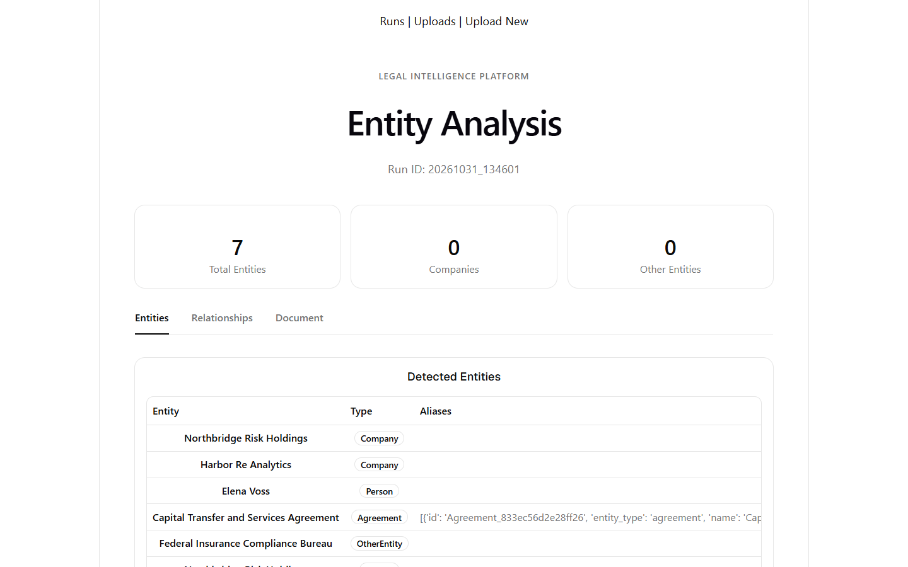
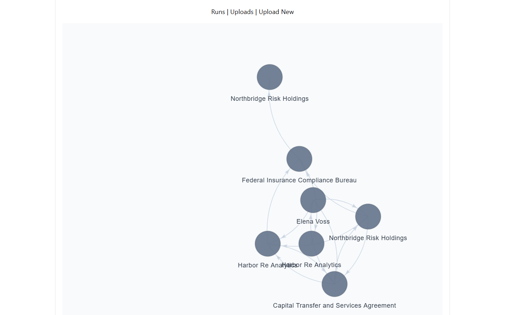
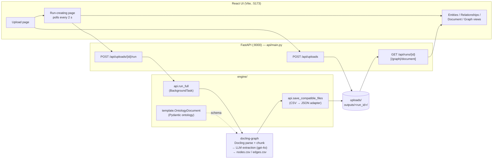
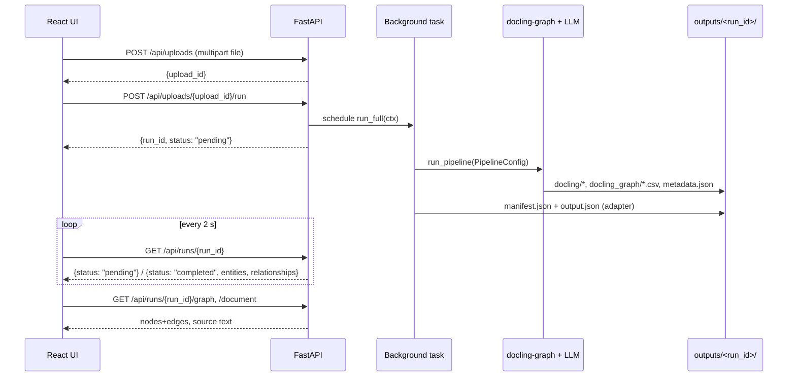

# Entity Resolution for Legal & Insurance Documents


Upload a legal or insurance document, get back a **knowledge graph of the people, companies, agreements and assets it mentions**, the typed relationships between them, and a pointer back to where in the document each one came from.

| Entities & types | Relationship graph |
|---|---|
|  |  |

*Screenshots are from a real run on a synthetic insurance document (`data/test-synthetic.txt`).*

## What it does

1. **Ingests** a document through a web UI or REST API.
2. **Parses and chunks** it with [Docling](https://github.com/docling-project/docling), then has an LLM (OpenAI `gpt-4o`) fill a strict Pydantic ontology via [docling-graph](https://github.com/docling-project/docling-graph).
3. **Stores** each run as an auditable, file-based artifact folder, and **serves** entities, relationships, the source text and a graph over a small REST API to a React UI.

## Architecture



The key design choice is the **adapter** (`save_compatible_files`): docling-graph emits graph CSVs; the adapter converts them to the stable `manifest.json` + `output.json` contract that the API and UI consume. The extraction backend can change without touching the frontend.

### Request lifecycle



## Ontology

Defined once in [`engine/template.py`](engine/template.py) as Pydantic models; the same schema drives LLM extraction and graph edge labels.

| Entity | Allowed outgoing relationships |
|---|---|
| `Person` | `controls` → Person / Company / Asset · `participates_in` → Agreement · `represents` → Person / Company · `related_to` → any |
| `Company` | same as Person |
| `Agreement` | `transfers_to` → Person / Company · `governs` → Person / Company / Asset · `related_to` → any |
| `Asset` | `transfers_to` → Person / Company · `governs` → Person / Company / Asset · `related_to` → any |
| `OtherEntity` | `related_to` → any |

The root `OntologyDocument` node links to every entity via `MENTIONS_PERSON`, `MENTIONS_COMPANY`, `CONTAINS_AGREEMENT`, `MENTIONS_ASSET`, `MENTIONS_OTHER_ENTITY`; the adapter drops the root node and its edges before serving results.

## Quickstart

**Prerequisites:** [uv](https://docs.astral.sh/uv/), Node.js and npm, an OpenAI API key, and a sibling checkout of docling-graph (it is installed as an editable local path, see `pyproject.toml`).

```sh
# 1. Layout: docling-graph must sit next to this repo
git clone https://github.com/docling-project/docling-graph.git ../docling-graph

# 2. Backend deps (first sync pulls torch + docling, so expect a few minutes)
uv sync

# 3. Secrets: create .env in the repo root with
#      OPENAI_API_KEY=...        used by docling-graph for extraction
#      OPENAI_API_LEGALDEV=...   read when run.py is imported
#      LANGFUSE_PUBLIC_KEY / LANGFUSE_SECRET_KEY / LANGFUSE_HOST
# api/main.py imports run.py, which creates an OpenAI client and a Langfuse
# client at import time, so the server expects all of these to be set.

# 4. Start the API (run from the repo root: uploads/ and outputs/ are cwd-relative)
uv run python -m uvicorn api.main:app --reload       # http://localhost:8000

# 5. Start the UI in a second terminal
cd frontend && npm install && npm run dev            # http://localhost:5173
```

Open <http://localhost:5173> (use `localhost`, not `127.0.0.1`; CORS allows only that origin), go to **Upload New**, drop a `.txt` file, and click **Create run**. A sample input is in [`data/test-synthetic.txt`](data/test-synthetic.txt).

> Always run Python through `uv run`. `requirements.txt` is stale; do not use it.

## Run artifacts

Every run is a self-contained, inspectable folder:

```text
outputs/<run_id>/                       # run_id = YYYYMMDD_HHMMSS
├── manifest.json                       # run id, source file, timestamp   ← served to UI
├── output.json                         # {entities[], relationships[]}    ← served to UI
└── <upload>_<txt>_<timestamp>/         # raw docling-graph output
    ├── metadata.json
    ├── docling/                        # document.md, document.json, chunks.json
    └── docling_graph/                  # nodes.csv, edges.csv, graph.html,
                                        # graph.json, provenance.json, report.md
```

Each entity carries `citations` built from docling-graph provenance (document id, chunk id, Docling item refs such as `#/texts/3`).

## API at a glance

| Method | Path | Purpose |
|---|---|---|
| `POST` | `/api/uploads` | Store a file, returns `upload_id` |
| `GET` | `/api/uploads` | List uploads |
| `POST` | `/api/uploads/{upload_id}/run` | Start a run in the background, returns `run_id` |
| `GET` | `/api/runs` | List runs |
| `GET` | `/api/runs/{run_id}` | `pending`, or `completed` with entities + relationships |
| `GET` | `/api/runs/{run_id}/graph` | `{nodes, edges}` for the graph view |
| `GET` | `/api/runs/{run_id}/document` | Source text for highlighting |

Request/response examples: [`docs/api.md`](docs/api.md).

## Documentation

- [`docs/architecture.md`](docs/architecture.md): stage-by-stage walkthrough with code references and the CSV → JSON field mapping
- [`docs/api.md`](docs/api.md): endpoints and payloads
- [`docs/frontend.md`](docs/frontend.md): routes, data flow, UI components
- [`docs/tests/`](docs/tests/README.md): test strategy, preflight, known issues

## Quality & testing

```sh
uv run python check.py          # pytest + frontend lint + frontend build, ~55 s
uv run python check.py --fast   # pytest only
```

The suite is **offline and free**, so it is safe to run before every paid run:

- A socket guard (`pytest-socket`) fails any non-loopback connection, dummy credentials are injected before imports, and Langfuse/LLM/docling calls are stubbed.
- `run_full` is tested with the paid call mocked but `PipelineConfig` real, so docling-graph config drift is caught before spending money.
- A contract test checks that every `fetch()` in `frontend/src` hits a route and method the API actually serves.
- Known bugs are pinned as `xfail(strict=True)`: fixing one turns the test red until the marker is removed, so the list cannot rot silently.

## Engineering decisions

- **Schema as contract.** One Pydantic ontology defines what the LLM may emit and which graph edges exist, which keeps output constrained and machine-checkable.
- **Adapter isolates the backend.** The UI depends only on `manifest.json` / `output.json`, so extraction engines are swappable (the earlier hand-rolled pipeline was replaced this way).
- **Provenance end to end.** Entities keep document, chunk and Docling item references so results can be audited against the source.
- **File-based runs.** No database needed: each run is reproducible, diffable and easy to inspect.

## Known limitations

Stated plainly; each is tracked with a test in [`docs/tests/known-issues.md`](docs/tests/known-issues.md).

- **Failed runs look pending.** The status endpoint has no failure state, so the UI polls forever if the background task crashes.
- **Citation offsets are placeholders.** Citations carry chunk and Docling refs, but `start_char`/`end_char` are `0` and `quote` holds the ref, not text.
- **Type vocabulary mismatch.** Entity types are class names (`Company`), while some UI grouping expects lowercase, so the Run page summary counts can show `0` for types that are present (visible in the screenshot above).
- **Relationships carry no evidence yet.** Edges have a type but an empty citation.
- **Hard-coded model.** `gpt-4o` is fixed in `engine/api.py`; only `.txt` upload is exposed in the UI.
- **Dev-only API.** CORS is `localhost:5173`, there is no auth, and `GET /debug` should be removed before any wider exposure.

## Repository layout (active code)

```text
api/main.py          FastAPI app: uploads, run launch, results
engine/api.py        run_full + CSV → manifest/output adapter
engine/template.py   Pydantic ontology (OntologyDocument)
frontend/src/        React UI (pages/, components/ui/)
tests/               offline pytest suite
check.py             one-command quality gate
docs/                deep-dive documentation
```

`run.py` still provides shared schemas (`Citation`, `CanonicalEntity`, `Relationship`) and the graph builder; its original standalone CLI pipeline and `test.py` are legacy and not documented here.
